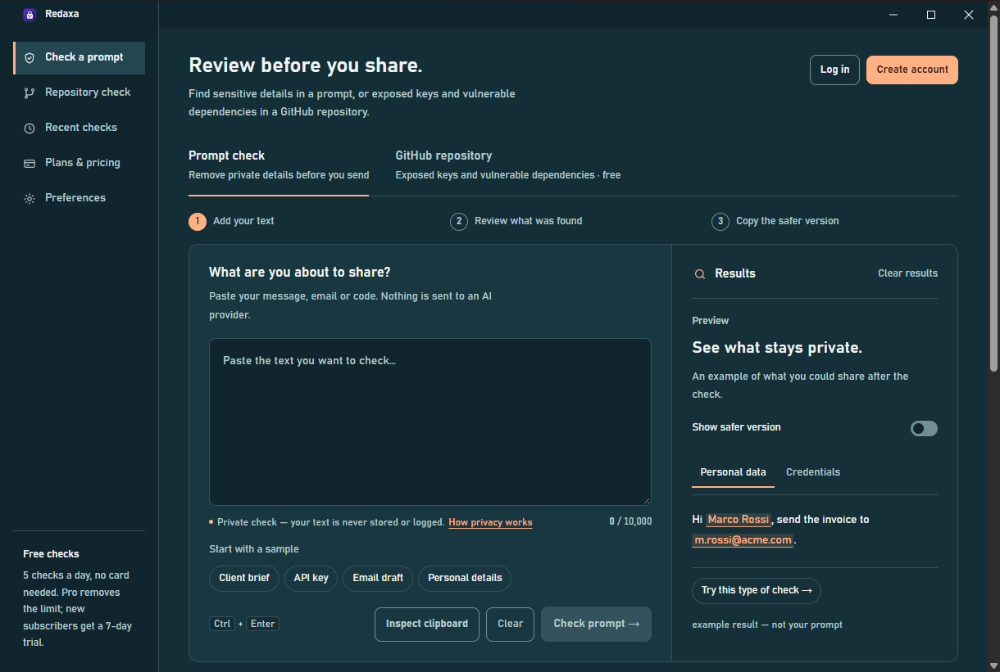

# Redaxa — Sensitive Data Checks for AI Prompts and Repositories

For people preparing prompts and reviewing repositories before sharing them. Inspect detected sensitive values and a redacted preview. Free extension checks run in the browser; web and Windows checks use the backend.

[Open Redaxa](https://redaxa.getcertsprint.com/) · [Official Windows downloads](https://github.com/AurelioAvila/redaxa/releases/latest) · [Verify the publisher signature](https://github.com/AurelioAvila/.github/blob/master/CODE_SIGNING.md)

**Reproducible example:** `Contact person@customer.example.` → `Contact [EMAIL].` The prompt-checking engine returns an email finding and a redacted preview for this reserved example address. This is a controlled example, not a customer submission or proof that every secret can be detected.

<p align="center">
  
</p>

<p align="center">
  <strong>Catch what you're about to leak, before it reaches an AI tool.</strong><br>
  Emails, secrets, cards, IBANs, private keys — flagged and redactable before you paste into ChatGPT, Claude, Gemini or Perplexity. Free checks in the Chrome extension run in your browser; web and Windows checks run on our backend. Nothing is sent to an AI provider — details in <a href="#privacy">Privacy</a> below.
</p>

<p align="center">
  <a href="https://redaxa.getcertsprint.com"></a>
  <a href="LICENSE"></a>
  <a href="../../releases"></a>
  <a href="https://github.com/microsoft/winget-pkgs/tree/master/manifests/a/AurelioAvila/Redaxa"></a>
</p>

<p align="center">
  <a href="https://www.softpedia.com/get/Security/PromptShield.shtml"></a>
  <a href="https://www.majorgeeks.com/files/details/redaxa.html"></a>
</p>

<p align="center"><sub>Want safer AI workflows? ⭐ Star Redaxa to follow new protections and help others find it.</sub></p>

<p align="center"><sub><strong>Redaxa was previously known as PromptShield.</strong> The official web app is redaxa.getcertsprint.com; existing Vercel links and released clients remain supported.</sub></p>

**Fastest way to try it — [web app](https://redaxa.getcertsprint.com), nothing to install** ·
[⬇ Latest Windows desktop app](../../releases/latest) ·
[Changelog](CHANGELOG.md) · [Privacy Policy](https://redaxa.getcertsprint.com/privacy.html) ·
[Terms](https://redaxa.getcertsprint.com/terms.html)

The [v0.6.12 Windows setup EXE](../../releases/tag/v0.6.12) was verified on October 29, 2026. Its SHA-256 is `04ce6d72d84a7e9b422fbfd36844f9c89dd5e9f76ba5f62f4886415b6132fc22`. Both public installers and the extracted `Redaxa.exe` passed `signtool verify /pa /all /tw` with **Aurelio Avila** publisher signatures, trusted timestamps and a passed revocation check. Their Tauri updater signatures were checked against the public key shipped in 0.4.4; the updater key is unchanged, and since 0.6.2 Redaxa also reads updates from dl.pctweaker.app before GitHub. See the [Windows signing verification guide](https://github.com/AurelioAvila/.github/blob/master/CODE_SIGNING.md). This evidence applies to those release artifacts; it is not a guarantee about future builds, the web app or extension. Use [latest release](../../releases/latest) for current downloads and notes.

**WinGet status (October 22, 2026):** Microsoft merged version 0.6.3 in [PR #458096](https://github.com/microsoft/winget-pkgs/pull/458096) on October 21; version 0.6.4 was submitted in [PR #458722](https://github.com/microsoft/winget-pkgs/pull/458722) and is awaiting validation. Each installer URL and hash is verified against the signed public release before submission. The package is recorded in the [official manifests](https://github.com/microsoft/winget-pkgs/tree/master/manifests/a/AurelioAvila/Redaxa); the downloadable WinGet catalog and local clients may take time to receive the update. Refresh the source with `winget source update --name winget`, then check `winget show --id AurelioAvila.Redaxa --exact --source winget`. If it still shows an earlier version, use [GitHub Releases](../../releases/latest) for the current signed build.

> The browser extension (source in [`browser-extension/`](browser-extension))
> is available on the [Chrome Web Store](https://chromewebstore.google.com/detail/redaxa/clkobbjoaegkgnmkibjghlboeoplpmok). The store publishes **0.4.14** (checked October 22, 2026; **0.4.15** was submitted for review the same day): free checks run inside the browser and send nothing, with an automatic check before sending on the supported sites that can be switched off in the popup. Accounts with an active plan use the Redaxa service, where workspace protected terms and team policies apply. It runs only on ChatGPT, Claude, Gemini and Perplexity, explains findings with a redacted preview, opens a short welcome on first install and is available in English, Italian, Spanish, French and German. It finds secrets assigned by name in `.env` files and configuration, passwords in connection URLs, Stripe webhook secrets, SendGrid keys, Slack webhook URLs and AWS secret access keys under the names the CLI and SDKs use, keeps an IBAN followed by its BIC whole, flags fewer type names and code expressions, replaces text cleanly on Perplexity, keeps the sign-in session out of reach of the AI sites' pages, applies the automatic-check switch to open tabs at once and keeps Ctrl+Enter when re-sending. It includes 0.4.11 (UK National Insurance numbers, checked Italian fiscal codes) and the 0.4.8 to 0.4.10 changes. Desktop and extension versions are independent. See the [extension release notes](browser-extension/RELEASE-NOTES.md).

---

## Why

You're about to paste a stack trace, a config file, or a client email into
ChatGPT. Somewhere in there is an API key, a card number, or someone's
email address you didn't mean to send. Redaxa helps you review it before you
hit enter, using patterns and category-specific checks: Luhn for card-number
candidates, mod-97 for IBANs and reserved-range filtering for SSNs. These
checks reduce some false positives; they do not prove that a match is
genuine or that every sensitive value will be found.

For a worked example, see [how to redact sensitive data before ChatGPT](https://redaxa.getcertsprint.com/redact-sensitive-data-before-chatgpt.html).

---

## What it does

Paste a prompt in. Redaxa highlights potential sensitive values and offers
a redacted version for you to review before sending.

| Category | Detected |
| --- | --- |
| **Personal data** | Email addresses, phone numbers, IPv4 addresses, names right after a greeting ("Dear John Smith,"), street addresses |
| **Credentials** | API keys and tokens (OpenAI, Stripe, AWS access key IDs and secret access keys, Google, GitHub, Slack), JWTs, private key blocks, passwords/secrets after `key: value` |
| **Financial data** | Card numbers (Luhn-checksum validated), IBANs (mod-97 checksum validated), crypto wallet addresses, Italian fiscal codes (check letter validated), US SSNs (reserved-range filtered), UK National Insurance numbers (unissued prefixes and placeholder examples filtered) |
| **Custom terms** | Your own project codenames, client names, anything you want flagged that isn't generic PII |

Detection combines patterns, known credential prefixes and category-specific
checks. A tracking number can still pass a card checksum, and an unfamiliar
secret can be missed. Review matches in context and use custom terms for
sensitive values outside the built-in rules.

### Review a GitHub repository on Windows

Pro and Business users can check a public GitHub repository for possible exposed credentials in the Windows app. The focused check reads current files; an optional extended check includes accessible Git history, dependencies and supported archives. Redaxa prioritizes likely API keys and tokens, shows coverage and exclusions, and exports a redacted report. Test, fixture and example values are counted but not listed, and a real-looking key in a test file is still listed as found in a test file; this relies on paths and value patterns and can be wrong. The repository check runs locally, unlike prompt scanning through Redaxa's backend. Findings need human review: Redaxa does not test whether a key works, revoke it, or perform a complete code vulnerability audit. [See the repository workflow](https://redaxa.getcertsprint.com/#repository) and [v0.4.1 release notes](release-notes/RELEASE-NOTES-0.4.1.md).

## For teams: the control layer

On the Business plan, a workspace is a real organization:

- **Policies** — per category (credentials, financial, personal, protected
  terms) an admin chooses *warn*, *redact* or *block*. Block removes "Send
  anyway" in the browser extension: the prompt does not leave until fixed.
- **Shared protected terms** — protect a project codename or client name
  once and every member's checks flag it, on every device and surface.
- **Explainable decisions** — every scan names the rule that decided and
  why, on every surface.
- **Audit trail, metadata only** — every check leaves an event (surface,
  detection kinds, decision). Never the prompt, never a value: the events
  table has no column that could hold content. Members see their own
  activity; owners and admins see the organization's.

## Where it runs

- **Web app** — [redaxa.getcertsprint.com](https://redaxa.getcertsprint.com), no install
- **Windows desktop app** — this repo's installer, signs in once and stays signed in (session held in the OS credential store, not a file on disk)
- **[Browser extension](https://chromewebstore.google.com/detail/redaxa/clkobbjoaegkgnmkibjghlboeoplpmok)** — a "Check" button and an automatic check before sending on ChatGPT, Claude, Gemini and Perplexity. Free checks run inside the browser, with no account and no daily limit

## Reviews and distribution

Ratings and reviews checked October 24, 2026. Feedback stays at its original source:

- [Softpedia](https://www.softpedia.com/get/Security/PromptShield.shtml): user rating **5.0/5**; editorial review **4.0/5**, tested by Softpedia staff. The listing keeps the PromptShield address from before the rename.
- [MajorGeeks](https://www.majorgeeks.com/files/details/redaxa.html): user rating **5/5**; listing and reader reviews.
- [WinGet](https://github.com/microsoft/winget-pkgs/tree/master/manifests/a/AurelioAvila/Redaxa): `winget install --id AurelioAvila.Redaxa --exact`.
- [Chrome Web Store](https://chromewebstore.google.com/detail/redaxa/clkobbjoaegkgnmkibjghlboeoplpmok): the browser extension.

Third-party listings may describe an older release and apply their own licence labels; this repository's [LICENSE](LICENSE) and [release notes](../../releases) are the authoritative sources.

## Privacy

**Where your prompt text goes depends on the surface.** Free checks in the
browser extension run entirely inside the browser with the same detection
engine, bundled with the extension; the text is not sent anywhere. The web
app, the desktop app and the extension with an active plan send the text to
Redaxa's own backend, which is where protected terms, team policies and the
metadata-only activity record live. What that server-side scan does *not* do: your text is never sent to a third-party AI
or classification service as part of scanning (`api/scan.ts` is regex/Luhn/
mod-97 logic, no outbound calls), and the request body is used only to
compute the response — never logged, stored, or forwarded anywhere; see
[`api/scan.ts`](api/scan.ts) and the full
[privacy policy](https://redaxa.getcertsprint.com/privacy.html). No
analytics, no ad trackers, no selling data. The desktop app never handles
your password directly for long — auth tokens live in Windows Credential
Manager, not in a plain file.

## Run locally

```bash
npm install
npm test
npm start
```

The team security tests create and remove a disposable local PostgreSQL
cluster; they never connect to an existing database. Install PostgreSQL and
make `pg_config` available on Unix, or use PostgreSQL 17's default Windows
installation. Set `POSTGRES_BIN` to its `bin` directory for other locations.
Run the tests as an ordinary OS user, not Unix root.

Open `http://127.0.0.1:4173/dashboard.html`. Account creation and billing
require the Vercel deployment (`api/`) with Supabase and Stripe configured
— see `.env.example`.
Apply `supabase/migrations/20261002_team_lifecycle.sql` before deploying the
updated team API. These transactional RPCs are restricted to the service role.

To build the Windows desktop app:

```bash
npx tauri build
```

## Product boundaries

Redaxa is a protective review layer, not a guarantee that all
sensitive data will be caught — detection has irreducible false negatives,
and you're always the one who decides what actually gets sent. The "Recent
checks" history stays in the browser's local storage. Checks processed on
the backend also leave a metadata-only activity record (never the text),
visible to you and, in a Business workspace, to its owners and admins.

Secret/credential detection matches known vendor prefixes (`sk-`, `AIza`,
`AKIA`, `ghp_`/`gho_`, `xox*-`, JWTs, `Bearer` tokens) — a generic
high-entropy API key without a recognizable prefix won't be flagged. If
your workflow involves custom or in-house token formats, add them as a
custom term rather than relying on the built-in credential patterns.

## Architecture notes

- [`scanner.ts`](scanner.ts) — the detection engine shared by every surface
- [`api/scan.ts`](api/scan.ts) — the endpoint the web app, the desktop app and the browser extension (with an active plan) call
- [`api/auth/*.ts`](api/auth) — thin proxies to Supabase Auth; the web app never handles raw tokens (httpOnly cookies), the desktop app and extension hold a Bearer token pair themselves
- [`api/billing.ts`](api/billing.ts), [`api/stripe-webhook.ts`](api/stripe-webhook.ts) — Stripe subscription lifecycle, backed by `supabase/migrations/` (RLS enabled, no public write policies)
- [`browser-extension/`](browser-extension) — the MV3 Chrome extension source
- [`src-tauri/`](src-tauri) — the Windows desktop app shell (Tauri v2 + Rust)

## License

Proprietary — all rights reserved. Source is visible for transparency; see [LICENSE](LICENSE) for terms. Not open for reuse, modification, or redistribution.

## Support

For support or billing questions, email [redaxa@getcertsprint.com](mailto:redaxa@getcertsprint.com). Include the app version and steps to reproduce the problem. Never send passwords, access tokens, private keys or payment card details, and remove sensitive information from screenshots and logs.

## More tools by Aurelio Avila

- [PC Tweaker](https://pctweaker.app/): Windows tuning for performance, gaming and privacy, with hardware monitoring and restore tools for supported settings.
- [PC Tweaker Uninstaller](https://pctweaker.app/uninstaller/): Windows uninstaller with evidence-based removal scores, rollback snapshots and a local removal ledger.
- [Tweaky Driver](https://pctweaker.app/tweaky-driver/): Windows driver inventory and update review, showing detected devices, installed versions and available driver offers.
- [Redexa Social](https://redexa.getcertsprint.com/): Private YouTube analytics for Windows, kept in a database on your PC.
- [Glarion](https://glarion.app/): Verified website security checks and white-label reports for digital agencies.
- [Frame Witness](https://framewitness.pages.dev/): Windows photo and video recovery with source offsets, SHA-256 hashes and dated findings.
